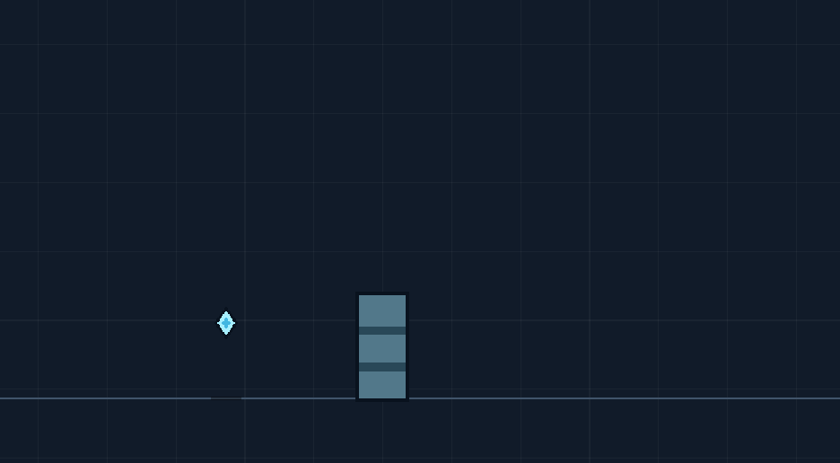
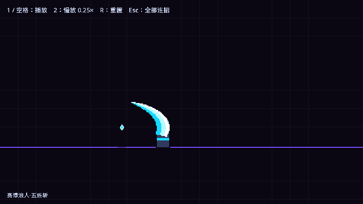
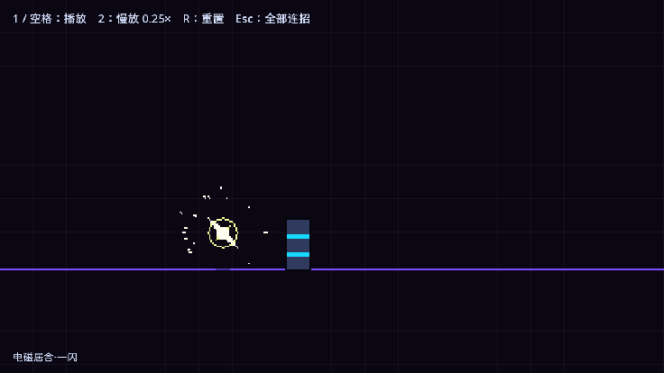
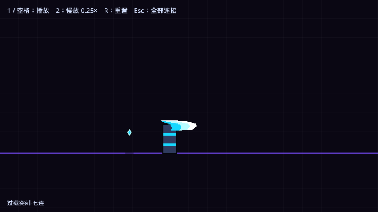
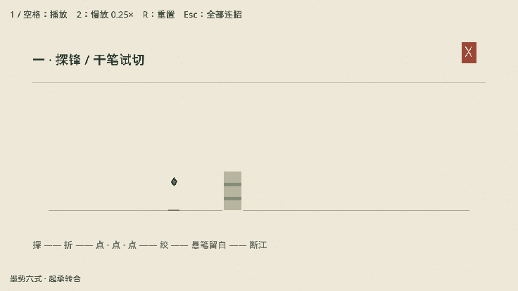

# combat-vfx-demo

[English](README.md)

用大白话描述一套连斩（招式、节奏、颜色、粗细），得到一个带格斗游戏打击感的 Godot 4 场景：
像素月牙刀光或轨迹刀光、星形命中火花、顿帧、击退、挑飞与下砸、震屏、连击数和终结技。
它是一个 AI 代理技能，仓库本身也是一个可以直接打开运行的 Godot 工程。
不需要美术素材、插件或自动加载，所有特效都由代码绘制。

## 用 Godot 打开

用 Godot 4.3+ 导入 `project.godot`，按 F5：画廊会列出所有连招。每组连招就是一个场景
`combos/<名字>/<名字>.tscn`。在编辑器里打开场景就能看到舞台，按 F6 循环播放。
按键：1 或空格重播，2 慢放，R 重置，Esc 回到画廊。

```
project.godot   main.tscn（画廊）
vfx/            特效代码：combo_player.gd（场景根节点）、combo_stage.gd（连招与默认像素绘制器）、
                pixel_slash.gd（像素刀光）、combo_style.gd（配色）、gallery.gd；
                ink_stage.gd + ink_stroke.gd（水墨绘制器）；
                ribbon_stage.gd + trajectory_ribbon.gd + trajectory_ribbon.gdshader（轨迹刀光）
combos/<名字>/  <名字>.tscn、combo.json（事件）、style.json（风格）、prompt.md（提示词）
styles/         风格预设：default、ember、neon、ink
tools/          new_combo.py、verify_combo.py、frames_to_gif.py、frames_to_review.py、
                verify_ink_forms.gd；capture_promo.gd、build_promo.py、review_promo.py（宣传视频）
references/     combo_events.md（格式）、choreography.md（需求 → 事件）
media/          下面展示用的 GIF 和逐帧拼图
SKILL.md        代理说明
```

## 作为技能使用

把本文件夹放进代理的技能目录（Claude Code：`~/.claude/skills/combat-vfx-demo/`），然后这样说：

> 第一刀横斩，第二刀竖劈，第三刀上挑，第四刀旋转攻击，终极技能空中连斩。节奏 慢 慢 快快快。颜色黑红，中等宽度。

> 三下快速突刺，接居合一闪，金色终结。霓虹配色，细刀光。

没说的部分都用默认值。代理会按 [references/choreography.md](references/choreography.md) 把连招写成事件时间轴，
作为一个新场景加进你的 Godot 工程（或新建一个演示工程），跑自检，并查看结果的逐帧拼图。

## 刀光怎么选：月牙还是轨迹

两种画法都能做斩击。建议按表现目的选择：**需要看清武器怎么挥过去，选轨迹刀光；
需要强调完整的月牙轮廓、剑气造型或夸张的大斩击，选月牙刀光。** 终结技也可以用轨迹刀光，
例如下面的「断空九式」；招式名字本身不决定绘制方式。

| 画法 | 适合的表现 | `style.json` 配置 |
|---|---|---|
| 月牙刀光 | 大范围斩击、剑气造型、强调完整轮廓的攻击 | 不写 `renderer`，或设为 `""` |
| 轨迹刀光 | 贴着武器的挥砍、连续拼刀、旋转斩、需要自然拖尾和收尾的动作 | `"renderer": "ribbon"` |

使用技能时直接说明选择，例如：

> 用轨迹刀光做一套连斩：两刀慢斩，接三刀快切，旋身上挑，最后重劈。蓝紫配色，金色终结。

> 用原来的月牙刀光做一套大斩击，突出清晰的月牙剑气轮廓。

目前代码按**整套演示**选择绘制器，不会根据招式自动逐刀切换；未配置 `renderer` 时仍使用月牙。
同一套中“普通挥砍用轨迹、最后一道剑气用月牙”的逐刀选择尚未实现。
`ribbon` 替换的是 `slash` 事件；命中火花、蓄力、直线刀痕等仍沿用现有实现。
这个选项只选择画法，不会自动增加飞行剑气等玩法。

轨迹刀光还需要配套编排时间：`slash.duration` 是挥刀时间，`tail` 是轨迹保留时间，
对应的 `hit.t` 应为 `slash.t + duration / 2`。不要只改绘制器名称而保留旧的命中时间。
完整例子见 [断空九式](combos/rift_dancer/README.md)，字段说明见
[事件格式](references/combo_events.md#sampled-trajectory-renderer)。

## 示例：提示词 → 效果

[combos/](combos) 下每个文件夹都有：提示词 `prompt.md`、代理据此写出的 `combo.json` 和 `style.json`，以及场景文件。

### 断空九式 · 轨迹刀光 — [combos/rift_dancer](combos/rift_dancer)

> 用轨迹刀光做一套炫酷演示：蓄势双斩、快速三连切、旋身上挑、空中双切、金刃重劈。

九击，蓝紫交替，金色上挑和终结。刀光沿挥刀轨迹逐段生成，旧段变细、变暗后删除；
沿用已有的命中、顿帧、击退、挑空、震屏和连击数。`style.json` 选择 `"renderer": "ribbon"`。



### 烈焰上挑 — [combos/ember_launcher](combos/ember_launcher)

> A thrust, then an X of two diagonal cuts, a gold rising launcher, and a red air slam to
> finish. Rhythm: slow, fast fast, medium, heavy. Fire colours, bold blades.

（突刺，接两刀交叉成 X 的斜斩，金色上挑，红色空中下砸终结。节奏 慢 快快 中 重。火焰配色，粗刀光。）


### 冰霜剑士 — [combos/frost_swordsman](combos/frost_swordsman)

> 冰霜剑士：先四下极快的连续突刺，停一拍后旋风斩转两圈，然后上挑把敌人挑飞，追上去空中乱斩三刀，最后一记重劈砸回地面。节奏 快快快快 慢 中 快快快 重。冰蓝配白，细刀光，像素颗粒粗一点。


### 赛博三连 — [neon_ronin](combos/neon_ronin)、[neon_iaido](combos/neon_iaido)、[neon_overdrive](combos/neon_overdrive)

基于 `neon` 预设：赛博浪人·五连斩、电磁居合·一闪、过载突刺·七连。

  

### 墨势六式 — [combos/ink_forms](combos/ink_forms)

六式七击，由独立的水墨绘制器（`"renderer": "ink"`）绘制：压力笔腹、飞白、墨滴和泼墨，不用月牙和星芒。
见[它的说明](combos/ink_forms/README.md)和[出招设计](combos/ink_forms/design.md)。



## 提示词对照：什么说法对应哪组特效

把需求按 **画法 → 招式顺序 → 节奏 → 命中反馈 → 外观** 写出来即可。
下面是代理编排演示时的对应关系：代理会把自然语言写成时间轴和风格配置，工程本身没有关键词解析器。

### 先说画法：刀光怎么出现

| 你可以这样说 | 对应的画面 | 选择 |
|---|---|---|
| “用轨迹刀光”“刀光跟着挥刀走” | 刀锋扫过后留下带状轨迹，旧段变细、变暗再消失 | `renderer: ribbon`；适合挥砍、拼刀、旋转斩 |
| “用原来的月牙”“完整的大月牙轮廓” | 预设月牙快速展开，再从尾端侵蚀收掉 | 默认绘制器；适合强调完整形状的大斩击 |
| “用水墨笔触”“要干笔、飞白、墨滴” | 笔腹、纤维和墨滴组成的独立水墨画法 | `renderer: ink`；参考「墨势六式」 |

画法按整套演示选择；只说“横斩”或“上挑”不代表自动切换绘制器。
不指定画法仍使用默认月牙。单纯选择 `ink` 配色预设也不会自动启用水墨笔触绘制器。

### 再说招式：往哪挥，打中后发生什么

| 你可以这样说 | 招式与目标反应 |
|---|---|
| “横扫一刀” | 横向展开的挥砍；小幅击退可另外指定 |
| “从头顶向下劈” | 从高到低挥刀；不会仅凭“下劈”就把目标挑空或砸地 |
| “两刀交叉成 X” | 两刀相反倾斜方向的斩击，分别命中 |
| “三次快速突刺，每次向前一点” | 三次细长刺击，分配少量前冲；当前直刺示例使用默认绘制器的扁平刀光 |
| “旋转两圈，每圈命中一次” | 刀光绕攻击方转两圈，共两次命中；圈数和命中数分别写清楚 |
| “向上挥一刀，把目标挑飞” | 上挥斩击，加向上的受击速度；“向上挥”指定方向，“挑飞”指定目标反应 |
| “跳起追上目标，空中连斩三次” | 攻击方追到空中，三次轻击续浮空；每刀可换方向 |
| “空中重劈，把目标砸回地面” | 下劈配向下的受击速度，目标落地并反弹；若还要终结光圈，明确说“作为终结技” |
| “向前冲一段，再横斩” | 前冲位移接横扫，刀光跟随攻击方 |
| “蓄力后居合一闪，穿过目标，延迟三道刀痕” | 蓄力、瞬移穿身、三次延迟刀痕，再接指定的命中；刀痕使用现有直线效果 |

同一种招式可以用不同刀光表现。攻击方目前是菱形标记、目标是方块；这些说法编排的是
位移、特效和受击反应，不会自动生成角色挥刀动画。

### 最后说节奏、力度和外观

| 你可以这样说 | 调整内容 |
|---|---|
| “慢、慢、快快快，停一拍，再重劈” | 前两刀留出间隔，接紧凑三连切，最后停顿蓄势；顿帧额外叠加，不挤掉出刀间隔 |
| “这一刀收快一点”“拖尾留久一点” | 调挥刀与收尾时间；轨迹刀光分别用 `duration` 控制挥刀、`tail` 控制轨迹保留时间 |
| “轻击，小幅击退，轻微震屏” | 小命中火花、短顿帧、轻击退和轻震屏 |
| “最后一下作为终结技，金色，重顿帧” | 放大命中火花和光圈，加长顿帧、增强震屏；最后一击完成后连击数使用强调色 |
| “普通刀光冰蓝，终结金色” | 分配普通色和强调色，并调整背景对比；没有指定用途的两种颜色通常按此分配 |
| “ember 配色”“neon 配色”“ink 配色” | 使用相应预设的色板与场景颜色；画法仍按上面的选择配置 |
| “细 / 中等 / 粗刀光” | 宽度倍率约为 ×0.6 / ×1.0 / ×1.4 |
| “细腻 / 颗粒粗 / 复古像素” | 每个纹理像素对应 2 / 4–5 / 6 个世界像素，默认 3 |

一个完整的例子：

> 用轨迹刀光。先横扫，再反向斜斩，接三刀快速交叉切；停一拍，旋身上挑把目标挑飞，
> 跳起追切两刀，最后重劈砸地作为终结技。前两刀慢，中间快，终结前留停顿。
> 普通刀光蓝紫交替，终结金色，中等宽度，像素 3。轻击微震，终结重顿帧。

没指定的部分由代理按 SKILL 默认值补齐：3～4 刀变化的连招，以上挑和终结收尾，
钢蓝色、中等粗细、像素 3，界面语言跟随提示词。出图后可以直接说“第二刀晚一点”
或“最后一刀再宽一些”，针对某一刀继续调整。

## 手动使用

```bash
python tools/new_combo.py my_combo --combo my_combo.json --style styles/neon.json --thickness bold
python tools/verify_combo.py my_combo --gif --godot /path/to/godot
```

这会在本工程里新增 `combos/my_combo/my_combo.tscn`，画廊里会自动出现它。
加 `--project 目录` 则加到别的 Godot 工程里（会把 `vfx/` 脚本复制过去）；目录是新的或空的，就新建一个演示工程。
verify_combo.py 加 `--media` 会把 GIF 和拼图复制到 `media/`。事件格式见 [references/combo_events.md](references/combo_events.md)（英文）。

参数：
- `--thickness`：thin、medium、bold 或一个数字；
- `--pixel`：像素颗粒大小；
- `--lang`：界面语言，en 或 zh；
- `--title`：标题；
- `--prompt`：提示词原文，存为 prompt.md；
- `--palette NAME=色,色,色,色`：替换一套刀光色板，从亮到暗；
- `--color 角色=色`：替换场景颜色。

## 自定义绘制器

风格预设（`default`、`ember`、`neon`、`ink`）只改颜色、粗细和像素颗粒。如果不喜欢现成的画法，
想换一种**绘制方式**（水墨、剪纸、矢量辉光、手绘序列帧……），就加一个绘制器。
事件时间轴、顿帧、击退、震屏、重播按键、慢放、录帧和自检都是共用的，绘制器只决定每个事件画成什么。

1. **舞台脚本**：新建 `vfx/<名字>_stage.gd`，`extends ComboStage`（保留 `@tool`）。只重写想换画法的部分，其余交给 `super`：
   - `_fire(event)`：`slash`、`charge`、`flash_step`、`cut` 等；不处理的事件调用 `super._fire(event)`；
   - `_hit(event)`：命中。保留默认实现里的记账——`hits += 1`、`_target_velocity`、`_stop = event.stop`、`_shake(...)`——否则自检和打击感会坏；
   - `_draw()` / `_refresh()`：需要时换背景和画面文字。
2. **特效节点**：你生成的笔触、火花等。任何 `Node2D` 加到 `fx`（舞台坐标）或 `attacker`（跟随攻击方）下，
   只要有 `advance(delta)` 和 `is_done()` 就行：舞台按连招时钟推进它（顿帧和慢放也会冻结它），结束后自动释放。
   在 `_draw()` 里画，不要用 `_process` 或真实时间。
3. **启用**：在连招的 `style.json` 里写 `"renderer": "<名字>"`，`combo_player.gd` 就会加载 `vfx/<名字>_stage.gd`；
   不写就用默认像素绘制器。
4. **自定义事件字段**：舞台可以读 `combo.json` 里自己的字段（水墨绘制器读 `ink_kind`），其他绘制器会忽略。
5. **检查**：`verify_combo.py <连招> --gif` 照样跑命中数自检和逐帧拼图；绘制器特有的检查可以仿照
   `tools/verify_ink_forms.gd` 另写脚本。

水墨绘制器就是现成的范例：[vfx/ink_stage.gd](vfx/ink_stage.gd)（约 100 行）和 [vfx/ink_stroke.gd](vfx/ink_stroke.gd)（约 120 行）。
也可以让代理来做：说“新做一个 X 风格的绘制器，不要给现有刀光换色”，并让它参考这一节。

## 许可

MIT，见 [LICENSE](LICENSE)。
