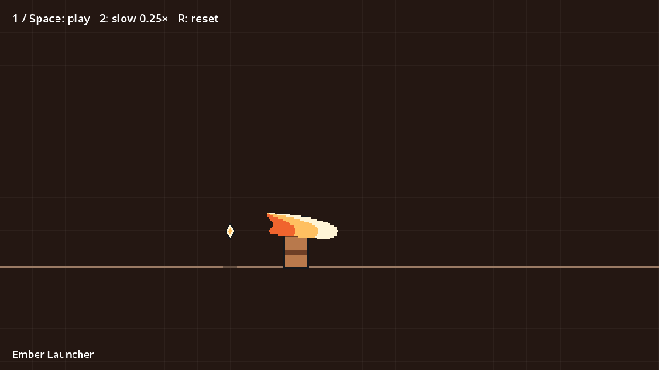
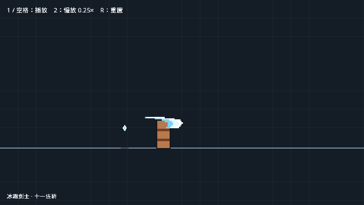

# combat-vfx-demo

[English](README.md)

用大白话描述一套连斩（招式、节奏、颜色、粗细），得到一个带格斗游戏打击感的 Godot 4 场景：
像素月牙刀光、星形命中火花、顿帧、击退、挑飞与下砸、震屏、连击数和终结技。
它是一个 AI 代理技能，仓库本身也是一个可以直接打开运行的 Godot 工程。
不需要美术素材、插件或自动加载，所有特效都由代码绘制。

## 用 Godot 打开

用 Godot 4.3+ 导入 `project.godot`，按 F5：画廊会列出所有连招。每组连招就是一个场景
`combos/<名字>/<名字>.tscn`。在编辑器里打开场景就能看到舞台，按 F6 循环播放。
按键：1 或空格重播，2 慢放，R 重置，Esc 回到画廊。

```
project.godot   main.tscn（画廊）
vfx/            特效代码：combo_player.gd（场景根节点）、combo_stage.gd（连招）、
                pixel_slash.gd（渲染器）、combo_style.gd（配色）、gallery.gd
combos/<名字>/  <名字>.tscn、combo.json（事件）、style.json（风格）、prompt.md（提示词）
styles/         风格预设：default、ember、neon、ink
tools/          new_combo.py、verify_combo.py、frames_to_gif.py、frames_to_review.py
references/     combo_events.md（格式）、choreography.md（需求 → 事件）
media/          下面展示用的 GIF 和逐帧拼图
SKILL.md        代理说明
```

## 作为技能使用

把本文件夹放进代理的技能目录（Claude Code：`~/.claude/skills/combat-vfx-demo/`），然后这样说：

> 第一刀横斩，第二刀竖劈，第三刀上挑，第四刀旋转攻击，终极技能空中连斩。节奏 慢 慢 快快快。颜色黑红，中等宽度。

> 三下快速突刺，接居合一闪，金色终结。霓虹配色，细刀光。

没说的部分都用默认值。代理会按 [references/choreography.md](references/choreography.md) 把连招写成事件时间轴，
作为一个新场景加进你的 Godot 工程（或新建一个演示工程），跑自检，并查看结果的逐帧拼图。

## 示例：提示词 → 效果

[combos/](combos) 下每个文件夹都有：提示词 `prompt.md`、代理据此写出的 `combo.json` 和 `style.json`，以及场景文件。

### 烈焰上挑 — [combos/ember_launcher](combos/ember_launcher)

> A thrust, then an X of two diagonal cuts, a gold rising launcher, and a red air slam to
> finish. Rhythm: slow, fast fast, medium, heavy. Fire colours, bold blades.

（突刺，接两刀交叉成 X 的斜斩，金色上挑，红色空中下砸终结。节奏 慢 快快 中 重。火焰配色，粗刀光。）



### 冰霜剑士 — [combos/frost_swordsman](combos/frost_swordsman)

> 冰霜剑士：先四下极快的连续突刺，停一拍后旋风斩转两圈，然后上挑把敌人挑飞，追上去空中乱斩三刀，最后一记重劈砸回地面。节奏 快快快快 慢 中 快快快 重。冰蓝配白，细刀光，像素颗粒粗一点。



## 提示词对照：什么说法对应哪组特效

按顺序写招式，再写节奏、颜色、粗细。每种说法对应一组特效：

| 说法 | 效果 |
|---|---|
| 横斩 / 横扫 | 扁平月牙横穿目标，小幅击退 |
| 竖劈 / 下劈 | 从高到低的圆弧月牙 |
| 斜斩；“交叉成 X” | 倾斜的月牙；两刀反向倾斜就交叉 |
| 突刺 / 刺击 | 细长扁平的枪形刀光，攻击方前冲 |
| 旋转攻击 / 旋风斩（“转两圈”） | 绕攻击方连续半圈月牙，朝前的半圈各命中一次 |
| 上挑 / 挑飞 | 向上的月牙，目标被挑到空中 |
| 空中连斩 / 空中乱斩 | 攻击方跳起追击，连续小命中让目标浮空 |
| 砸地 / 重劈砸回地面 | 目标被砸向地面并反弹，地面光圈 |
| 冲刺斩 | 大幅前冲加扁平横扫 |
| 居合 / 一闪 | 金色蓄力闪光，攻击方瞬间穿过目标，目标身上浮现刀痕，然后爆开 |
| 终极 / 终结 / 必杀 / 最后一招“重” | 最大的火花和光圈，长顿帧，强震屏，连击数变金 |
| 节奏：慢 / 中 / 快 / 极快 | 间隔长 / 中 / 短 / 极短，每次命中的顿帧随之变化 |
| 颜色：两种颜色（黑红、冰蓝配白……） | 第一种做普通刀光，第二种做上挑和终结的强调色；背景会按对比度调整 |
| 预设名：ember、neon、ink | 使用该预设的色板和场景配色 |
| 细 / 中等 / 粗 | 刀光粗细 ×0.6 / ×1.0 / ×1.4 |
| 细腻 / 颗粒粗 / 复古 | 像素颗粒 2 / 4–5 / 6（默认 3） |

没说的都用默认值：3～4 刀变化的连招，以上挑和终结收尾，钢蓝色，中等粗细，像素 3，界面语言跟随你的提示词。

## 手动使用

```bash
python tools/new_combo.py my_combo --combo my_combo.json --style styles/neon.json --thickness bold
python tools/verify_combo.py my_combo --gif --godot /path/to/godot
```

这会在本工程里新增 `combos/my_combo/my_combo.tscn`，画廊里会自动出现它。
加 `--project 目录` 则加到别的 Godot 工程里（会把 `vfx/` 脚本复制过去）；目录是新的或空的，就新建一个演示工程。
verify_combo.py 加 `--media` 会把 GIF 和拼图复制到 `media/`。事件格式见 [references/combo_events.md](references/combo_events.md)（英文）。

参数：
- `--thickness`：thin、medium、bold 或一个数字；
- `--pixel`：像素颗粒大小；
- `--lang`：界面语言，en 或 zh；
- `--title`：标题；
- `--prompt`：提示词原文，存为 prompt.md；
- `--palette NAME=色,色,色,色`：替换一套刀光色板，从亮到暗；
- `--color 角色=色`：替换场景颜色。

## 许可

MIT，见 [LICENSE](LICENSE)。
